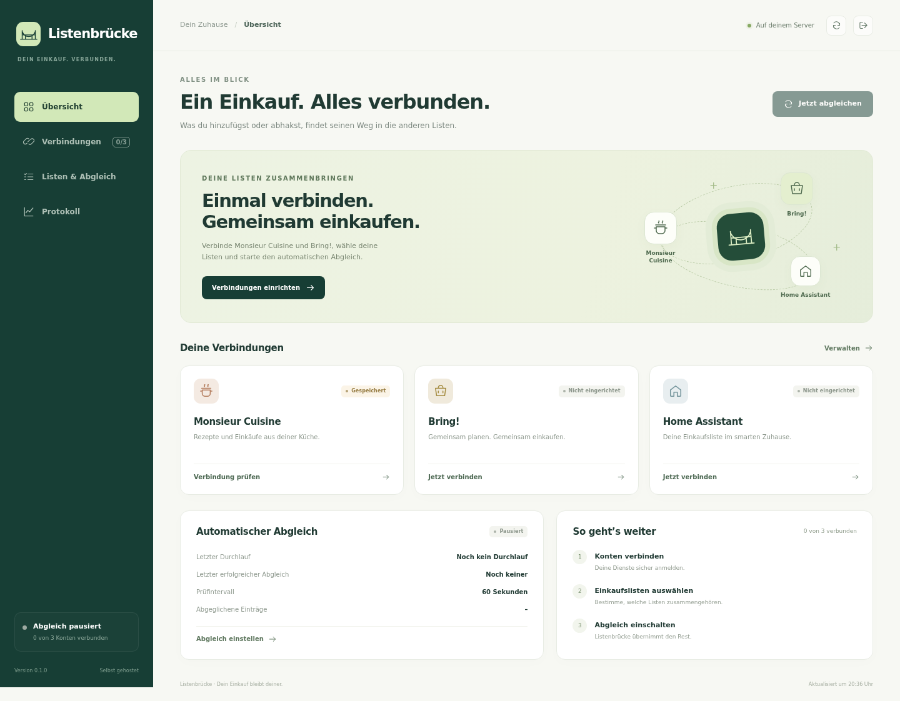

<p align="center">
  
</p>

<h1 align="center">Deine Listen. Ein Einkauf.</h1>

<p align="center">
  <strong>Listenbrücke verbindet Monsieur Cuisine, Bring! und Home Assistant.</strong><br>
  Selbst gehostet. Mit deutscher Oberfläche. Als Home-Assistant-App oder mit Docker.
</p>

<p align="center">
  <a href="https://xerx12.github.io/listenbruecke/">Projektseite</a> ·
  <a href="#installation">Installation</a> ·
  <a href="listenbruecke/DOCS.md">Dokumentation</a> ·
  <a href="https://github.com/xerx12/listenbruecke/issues">Fehler melden</a>
</p>

<p align="center">
  <a href="https://github.com/xerx12/listenbruecke/actions/workflows/tests.yml"></a>
  &nbsp; <strong>v0.1.0 · experimentell</strong> &nbsp; · &nbsp; <a href="LICENSE">MIT-Lizenz</a>
</p>



*Beispielansicht der Oberfläche. Keine persönlichen Kontodaten.*

## Was Listenbrücke kann

Das Rezept liegt in Monsieur Cuisine, die Einkaufsliste in Bring! und das Zuhause
läuft mit Home Assistant. Listenbrücke gleicht die ausgewählten Listen regelmäßig
ab, damit du Einträge und Abhakstatus zusammenhalten kannst.

- **Konten verbinden und testen:** Bring!-Anmeldung, Lidl-Anmeldung im eigenen
  Browser und optionale Verbindung zu einer getrennten Home-Assistant-Liste.
- **Artikel und Mengen erhalten:** Namen und Mengen werden als Text abgeglichen.
  Verschiedene Mengen und mehrfach vorkommende Zutaten bleiben unterscheidbar.
- **Abhaken und wieder öffnen:** Der Status bekannter Einträge wird beim nächsten
  Abgleich in die anderen Listen übernommen.
- **Automatisch oder auf Knopfdruck:** Prüfintervall zwischen 30 und 3600 Sekunden,
  manueller Start und Statusanzeige für laufende Abgleiche.
- **Änderungen nachvollziehen:** Das Protokoll zeigt Verbindungsfehler und Konflikte.
  Gespeicherte Artikelzuordnungen bleiben über Neustarts erhalten.
- **Löschungen bewusst steuern:** Das Übertragen von Löschungen ist standardmäßig aus.
  Ein fehlgeschlagener Abruf wird niemals als leere Liste behandelt.

Eine Bring!-Liste, die bereits in Home Assistant angezeigt wird, ist dieselbe Liste.
Sie wird nicht zusätzlich als unabhängige HA-Liste verbunden. **Eine eigene lokale
Home-Assistant-Liste ist optional**; Monsieur Cuisine und Bring! reichen aus.

## Stand

**Version 0.1.0 ist experimentell.** Tests prüfen die Anbieter-Anbindungen und den
Abgleich mit simulierten Antworten sowie die echte lokale Weboberfläche mit
synthetischen Konten. Anmeldung und vollständiger Abgleich müssen zusätzlich mit
den eigenen Konten geprüft werden. Die inoffiziellen Anbieter-Schnittstellen können
sich ändern.

Bei **Monsieur-Cuisine-Rezeptzutaten** wird ausschließlich der Erledigt-Status
zurückgeschrieben. Namen, Mengen und einzelne Löschungen dieser Zutaten sind
geschützt. Freie Einträge unterstützen Anlegen, Ändern, Abhaken und Löschen.

| Funktion | Bring! | MC: freie Einträge | MC: Rezeptzutaten | Eigene HA-Liste |
| --- | --- | --- | --- | --- |
| Lesen | ✓ | ✓ | ✓ | ✓ |
| Anlegen | ✓ | ✓ | – | ✓ |
| Name und Mengenangabe ändern | ✓ | ✓ | geschützt | ✓¹ |
| Abhaken / wieder öffnen | ✓ | ✓ | ✓ | ✓ |
| Einzelnen Eintrag löschen² | ✓ | ✓ | geschützt | ✓ |

¹ In einer nativen HA-Einkaufsliste steht die Mengenangabe im Artikeltext.
² Übergreifendes Löschen muss ausdrücklich eingeschaltet werden.

## Installation

### Home Assistant

Für **Home Assistant OS oder eine Installation mit Supervisor**:

[](https://my.home-assistant.io/redirect/supervisor_add_addon_repository/?repository_url=https%3A%2F%2Fgithub.com%2Fxerx12%2Flistenbruecke)

1. Das Repository über den Button zum App-Store hinzufügen.
2. **Listenbrücke** installieren und starten. Das Image wird aus dem Repository gebaut.
3. **Weboberfläche öffnen** wählen. Der Zugang erfolgt über Home Assistant Ingress.
4. Konten verbinden, Listen auswählen und den Abgleich einschalten.

Falls du die URL manuell eintragen möchtest:

```text
https://github.com/xerx12/listenbruecke
```

Die interne Home-Assistant-Verbindung wird vom Supervisor bereitgestellt. Die App
benötigt weder Host-Netzwerk noch privilegierten Modus oder Zugriff auf das
Home-Assistant-Konfigurationsverzeichnis. Ein Home-Assistant-Container ohne
Supervisor kann die Docker-Variante verwenden.

### Docker Compose

Voraussetzung: Docker mit Compose und Git auf dem eigenen Host.

```sh
git clone https://github.com/xerx12/listenbruecke.git
cd listenbruecke
docker compose up --build -d
```

Danach die Oberfläche auf **Port 8099** des Docker-Hosts öffnen, lokal etwa unter
`http://localhost:8099`. Beim ersten Aufruf ein Passwort mit mindestens zwölf
Zeichen festlegen. Das persistente Volume `listenbruecke_data` muss bei Updates
erhalten bleiben.

Für Zugriff außerhalb des eigenen Netzes einen HTTPS-Reverse-Proxy verwenden.
Eigene Domains werden über `LISTENBRUECKE_ALLOWED_HOSTS=listen.example.org`
freigegeben, mehrere Namen kommasepariert. `LISTENBRUECKE_SECURE_COOKIE=1` aktiviert
sichere Sitzungscookies. Standardmäßig sind lokale Adressen erlaubt.

### Konten einrichten

1. **Bring!:** E-Mail und Passwort in der eigenen Listenbrücke-Oberfläche eingeben,
   speichern und die Verbindung testen.
2. **Monsieur Cuisine:** Den mitgelieferten Browserhelfer herunterladen und als
   entpackte Chrome-/Edge-Erweiterung installieren. **Mit Lidl anmelden** öffnen,
   die Anmeldung direkt bei Lidl abschließen und das Anmeldeergebnis des Helfers
   in die eigene App einfügen. Anmeldecodes niemals in Issues oder Chats teilen.
3. **Home Assistant:** Im Add-on über den Supervisor verfügbar. Im Docker-Betrieb
   kann bei Bedarf eine Instanz-URL mit Zugriffstoken eingetragen werden.
4. **Listen & Abgleich:** Gewünschte Listen auswählen, Intervall festlegen und
   speichern. Danach den automatischen Abgleich aktivieren.

Weitere Einrichtung, Fehlerbehebung und Backups: [Dokumentation](listenbruecke/DOCS.md).

## Wie der Abgleich mit Änderungen umgeht

Artikel-IDs und letzte bestätigte Werte werden dauerhaft gespeichert. Änderungen
werden vor dem Schreiben vorgemerkt und anschließend bestätigt. Historische,
bereits erledigte Einträge werden beim ersten Einlesen nicht als neue Einkäufe
in alle Listen übernommen.

Gleichzeitige widersprüchliche Änderungen bleiben als Konflikt im Protokoll sichtbar.
Die Angaben können in den betroffenen Anbieter-Apps angeglichen werden. Bei einem
unklaren Schreibausgang wird nicht blind erneut angelegt. Bewusst entfernte Einträge
werden ebenfalls nicht einfach wiederhergestellt.

Mengen bleiben Text. Unterschiedliche Einheiten werden nicht automatisch addiert.
Geschützte Rezeptzutaten werden niemals durch Entfernen des gesamten Rezepts gelöscht.

## Daten & Sicherheit

- Zugangsdaten werden mit **Fernet authentifiziert verschlüsselt** in SQLite gespeichert.
- Der Schlüssel liegt mit Dateirechten `0600` im selben privaten Datenverzeichnis.
  Das schützt vor versehentlichen Datenbankkopien, nicht vor administrativem Zugriff
  auf das vollständige Volume.
- Für Backups immer **Datenbank und Schlüssel zusammen** sichern.
- Das lokale Oberfläche-Passwort wird mit gesalzenem Scrypt gehasht; Sitzungen nutzen
  HttpOnly-Cookies. API-Antworten enthalten keine gespeicherten Passwörter oder Tokens.
- Bring! und Monsieur Cuisine benötigen weiterhin die Cloud-Dienste der Anbieter.
  Es gibt keinen zusätzlichen Listenbrücke-Cloud-Dienst.
- Reale Konten, Tokens, App-Daten und lokale Laufzeitdateien gehören nicht in Git
  oder öffentliche Fehlerberichte.

## Entwicklung

Voraussetzungen: **Python ≥ 3.12**; für Browserprüfungen zusätzlich Node.js.

```sh
python3 -m venv .venv
.venv/bin/pip install -e './listenbruecke[test]'
PYTHONPATH=listenbruecke/src .venv/bin/pytest listenbruecke/tests
node --test listenbruecke/tests/test_browser_helper.cjs
npm --prefix listenbruecke ci
npx --prefix listenbruecke playwright install chromium
npm --prefix listenbruecke run test:ui
LISTENBRUECKE_TEST_PYTHON="$PWD/.venv/bin/python" npm --prefix listenbruecke run test:ui:backend
LISTENBRUECKE_DATA=./data .venv/bin/listenbruecke
```

Die Projektseite unter `docs/` ist statisches HTML, CSS und JavaScript. Sie benötigt
keinen Build und wird über GitHub Pages veröffentlicht.

## Mitmachen & Lizenz

Fehler oder Ideen? [Ein Issue öffnen](https://github.com/xerx12/listenbruecke/issues)
oder eine Änderung als Pull Request vorschlagen. Bitte nur bereinigte Fehlermeldungen
und synthetische Beispieldaten veröffentlichen.

[MIT-Lizenz](LICENSE). Übernommene Teile und ihre Lizenzen stehen in den
[Drittanbieter-Hinweisen](listenbruecke/THIRD_PARTY_LICENSES.md).

**Inoffiziell:** Keine Verbindung, Unterstützung oder Empfehlung durch Bring! Labs,
Lidl, Monsieur Cuisine, Tecpal oder Home Assistant. Produktnamen gehören ihren
jeweiligen Inhabern.
